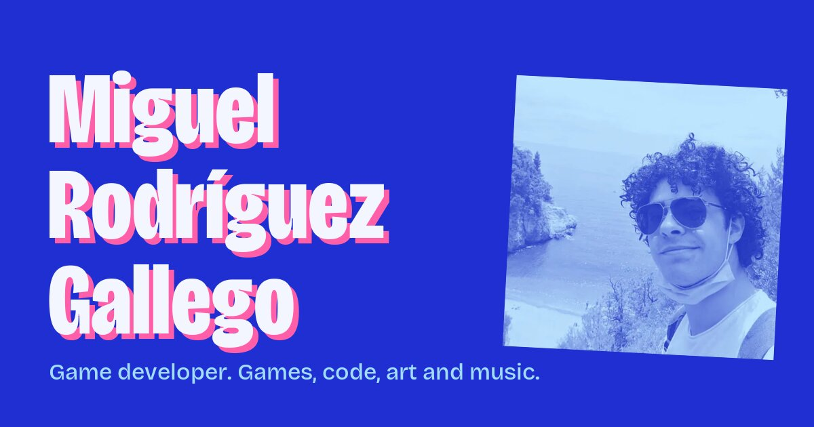

# Miguel Rodríguez Gallego: personal site

[](https://github.com/miguelrg14/Personal-Web-Page_Miguelrg14/actions/workflows/ci.yml)

**▶ [miguelrg14.github.io/Personal-Web-Page_Miguelrg14](https://miguelrg14.github.io/Personal-Web-Page_Miguelrg14/)**

My portfolio and link page: games, code repositories, art and music, all in one place.
It's plain HTML, CSS and JavaScript with no build step, published by GitHub Pages straight from `main`.



## Pages

| Page | What it shows |
|---|---|
| [Home](index.html) | Who I am, every place to find me (it replaces my old Linktree) and selected work |
| [Games](games/index.html) | Each game with my role, the team, a preview and links to play it |
| [Code](code/index.html) | All my repositories grouped by topic, with tag filters |
| [Art](art/index.html) | Illustration, pixel art, 3D and drawing, with a lightbox |
| [Music](music/index.html) | Tracks, the sound I made for my games, mixing and DJing |
| [Contact](contact/index.html) | A form that opens your email app, plus all my links |

## Adding a project

Every game and repository comes from [`data/projects.js`](data/projects.js). To add one:

1. Put a cover image in `assets/projects/` (WebP, about 1200 px wide) and, optionally, a short muted MP4 that
   plays when the card is hovered.
2. Copy an entry in `data/projects.js` and change its fields. `kind: "game"` puts it on the Games page;
   `group` chooses its section on the Code page; `featured: true` shows it on the home page.

## Running it locally

Open `index.html` through any static server (the project list is loaded with JavaScript):

```bash
npm start            # http://localhost:8080
npm install && npm run validate   # HTML validation, also run by CI
```

CI validates the HTML and checks that every local link and asset exists.

## Credits

- Typeface: [Bricolage Grotesque](https://github.com/ateliertriay/bricolage) (SIL Open Font License, see
  [`assets/fonts/OFL.txt`](assets/fonts/OFL.txt)), served from the site itself.
- Brand icons: [Simple Icons](https://simpleicons.org) (CC0).
- Screenshots and clips come from the repositories of each project.
